# Olist E-commerce Analysis

## Project Overview

This project analyses data from Olist, a Brazilian online marketplace, covering over 100,000 orders across nine related tables. Using SQL, I combined data from multiple tables to investigate sales performance, seasonality, customer experience and customer retention. I then used Tableau to present the results through interactive dashboards, making the findings easier to interpret and communicate.

The aim was to develop practical data analysis skills while demonstrating how data can identify business opportunities, highlight potential issues and support evidence-based recommendations.

## Business Questions

1. **Sales Performance:** Which product categories and Brazilian states generate the highest sales?
2. **Seasonality:** How does sales performance change throughout the year, and which product categories show the strongest seasonal trends?
3. **Customer Experience:** Which products/categories are driving lower review scores, and is there a relationship between delivery times and review scores?
4. **Customer Retention:** How many customers make repeat purchases, and which product categories have the highest repeat-purchase rates and volumes?

## Dataset

The analysis uses the [Brazilian E-Commerce Public Dataset by Olist](https://www.kaggle.com/datasets/olistbr/brazilian-ecommerce), which contains over 100,000 orders from 4 September 2016 to 17 October 2018. It consists of nine related tables covering orders and their timestamps, customer reviews, products, category translations, customers, geolocation, order items, order payments and sellers.

### Data Cleaning and Quality Checks

Before analysis, I investigated missing values and inconsistencies to determine which records were suitable for each analysis.

- **Missing delivery dates:** `order_delivered_customer_date` contained 2,965 NULLs. Of these, 2,957 were explained by order status (cancelled, unavailable or not yet delivered). The remaining eight orders were marked as delivered but had no delivery date and were excluded from any analysis requiring one.
- **Missing product information:** 610 products had missing category, name length and description length values, and these appeared to relate to the same products.
- **Inconsistent timestamps:** 166 records had a purchase timestamp after the carrier handover timestamp, and 23 delivered orders had a customer delivery timestamp before carrier handover. These were retained in the raw data but excluded from analyses relying on the chronological order of handover and delivery.

## Methodology

I used SQL (SQLite) to join the nine tables on identifiers such as `order_id`, `product_id`, `customer_id`, `product_category` and `seller_id`, then used filtering, aggregation, `GROUP BY` and `CASE` statements to compare results across categories, regions and time periods.

- **Sales and revenue:** Sales volume was measured by counting order-item records, and seller revenue by summing product prices. Profit could not be calculated because the dataset contains no cost information.
- **Customer experience:** Average review scores were calculated overall and by category and seller. Delivery duration was calculated from purchase and customer-delivery timestamps, then grouped into time bands.
- **Retention:** I identified repeat customers, calculated the repeat-purchase rate and examined customers who bought from the same category more than once.
- **Seasonality:** I used 2017, the only complete calendar year, to compare monthly and quarterly patterns, and compared each category's quarterly sales share with the marketplace-wide distribution.
- **Visualisation:** Tableau dashboards containing charts, maps and heat maps present the results.

---

## 1. Sales Analysis

### Geographic Sales Performance

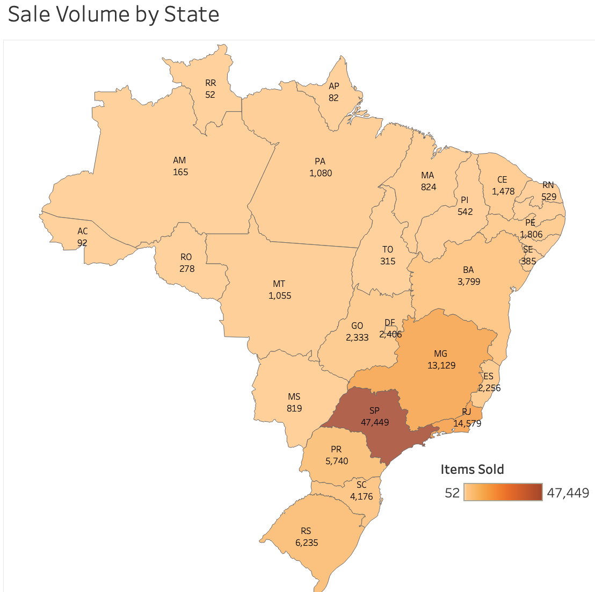

Sales were heavily concentrated in Brazil's Southeast, which accounted for roughly 60% of orders. São Paulo recorded 47,449 order-item records, and it, Rio de Janeiro and Minas Gerais were the only states with more than 10,000.

**Implication:** Seller recruitment and logistics partnerships may be most valuable in high-demand states. Analysing sales per customer by state would help separate large markets from those with unusually strong purchasing relative to their customer base.

### Product Category Performance

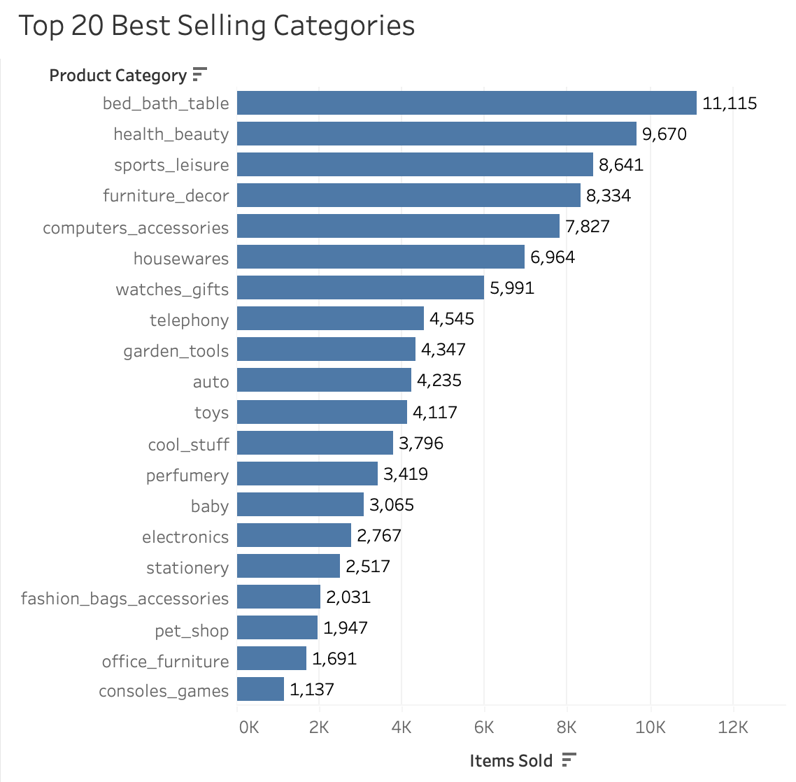

The dataset contained 71 product categories, with demand concentrated around a group of popular ones. Bed, Bath & Table led with more than 11,100 order-item records, followed by Health & Beauty and Sports & Leisure. Health & Beauty and Bed, Bath & Table featured among the top categories in many states, Furniture & Decor performed strongly in several (including Rio de Janeiro), and Bahia showed notable Sports & Leisure sales. No state had a category that stood out against the national pattern, suggesting widespread rather than region-specific demand.

**Implication:** Olist could share category-level demand insights with sellers to support stock planning. Comparing category sales with customer numbers per region would show whether any regional differences reflect genuinely stronger demand.

### Seller Performance and Revenue Distribution

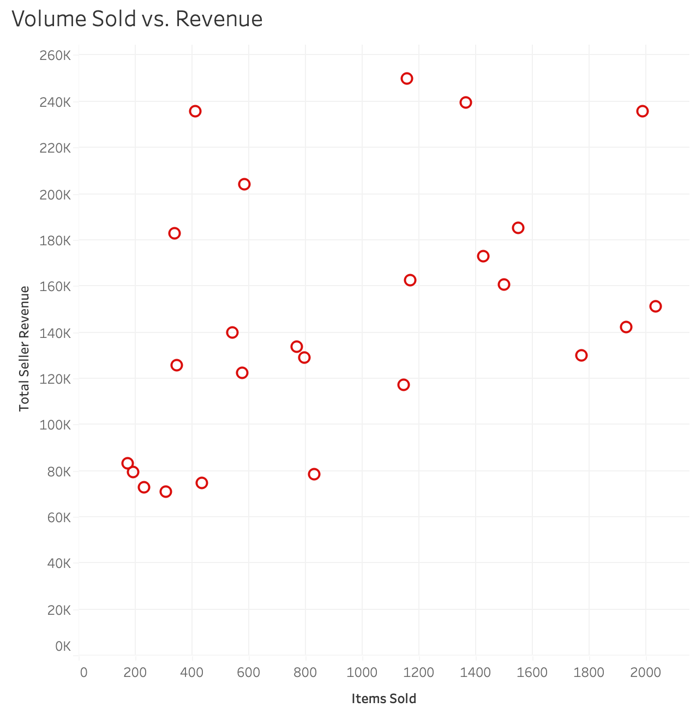

Of 112,650 order-item records in total, the top 10 sellers accounted for 14.15%, so sales were not dominated by a few sellers. Seller rankings changed depending on whether they were measured by items sold, product revenue, freight revenue or total revenue, so volume alone is a poor measure of performance.

| Revenue measure | Marketplace total | Top 10 sellers | Share |
|---|---|---|---|
| Product revenue | ~13.59m | ~1.79m | 13.15% |
| Freight revenue | ~2.25m | ~314,000 | 13.95% |
| Total revenue | ~15.84m | ~2.03m | 12.8% |

One seller ranked seventh by total revenue despite selling only 340 items.

**Implication:** High-revenue, low-volume sellers are worth investigating to see whether they sell higher-priced products or operate in particular categories. Sellers with high freight charges relative to product value could be compared against delivery times and review scores.

---

## 2. Seasonality Analysis

This section uses 2017 to examine whether individual categories followed the same seasonal pattern as the wider marketplace.

### Quarterly Sales Distribution

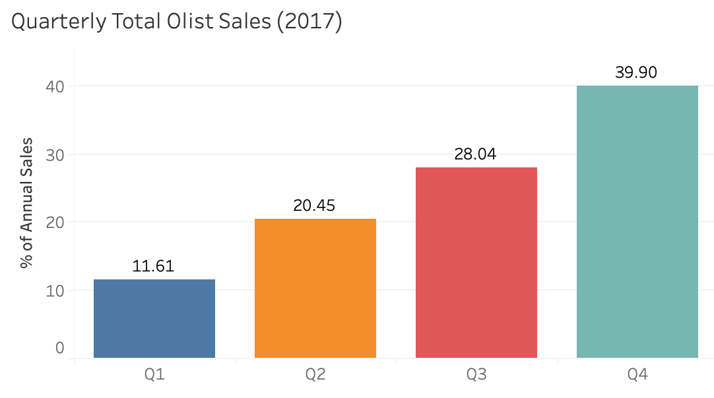

Sales built throughout the year, with Q4 accounting for 39.9% of annual order-item records, compared with 28.0% in Q3, 20.5% in Q2 and 11.6% in Q1. Q4 was therefore more than three times the Q1 share, though this marketplace-wide pattern does not apply equally to every category.

### Product Category Seasonality

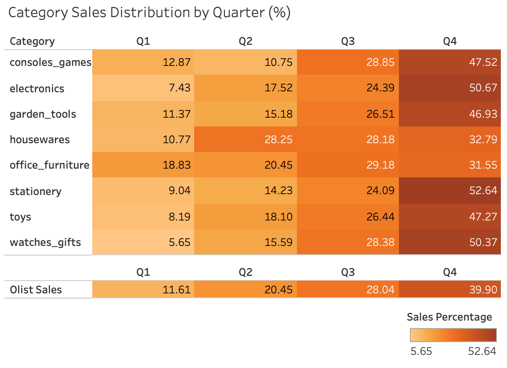

Comparing each category's quarterly distribution with the marketplace pattern highlighted several differences:

- **Strong Q4 concentration:** Stationery (52.6%), Electronics (50.7%) and Watches & Gifts (50.4%) each generated more than half their annual sales in Q4. Console Games (47.5%), Toys (47.3%) and Garden Tools (46.9%) were also well above the 39.9% platform-wide figure. Console Games and Garden Tools were weak in Q2 (10.7% and 15.2%, against 20.5% overall).
- **Earlier-year demand:** Housewares recorded 28.3% of annual sales in Q2, around eight percentage points above the marketplace distribution, with a lower Q4 share of 32.0%. Office Furniture had 18.8% of sales in Q1 (against 11.6% overall) and a lower Q4 share of 31.0%.

Q4 dominated overall, but some categories had stronger demand earlier in the year, so a single seasonal strategy would not suit every category.

### Monthly Patterns

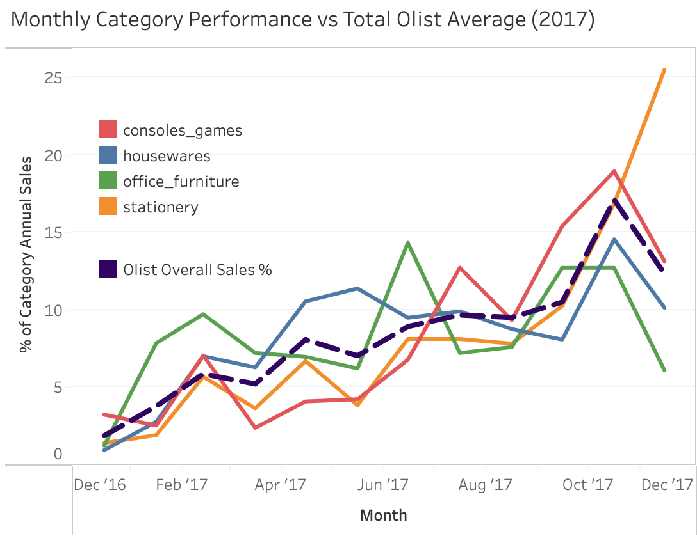

Monthly analysis checked whether the quarterly differences reflected sustained demand or individual strong months. It supported the year-end concentration for Stationery and Console Games and the stronger Q2 for Housewares. Office Furniture showed a notable July increase, with unique customers rising from 45 in June to 96 in July before falling to 46 in August. The increase was spread across a broad range of products, suggesting wider category demand rather than one product or a few unusually large orders.

### Console Games: Product-Level Drivers

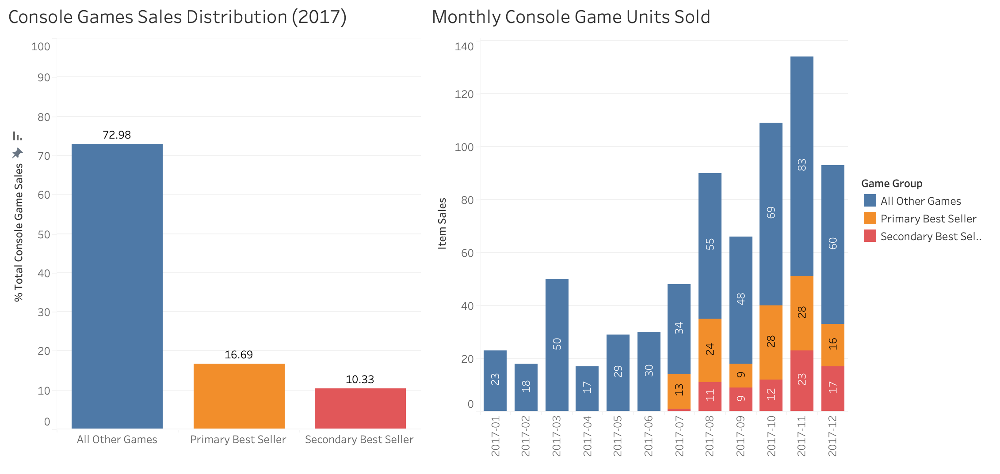

Console Games contained 317 distinct products, but the top two accounted for roughly 27% of annual category sales. Splitting monthly sales into these two titles and the rest of the category showed that they contributed heavily in October, November and December, so the category's Q4 peak was partly driven by a small number of products. Possible explanations include game popularity, product launches, promotions or events such as Black Friday, but the sales data alone cannot establish which.

**Implication:** Stock planning and promotions are better aligned to category-specific patterns than to a single year-end peak. Product-level analysis explained the quarterly pattern more fully than category totals alone.

---

## 3. Customer Reviews and Delivery Performance

### Category Revenue and Review Scores

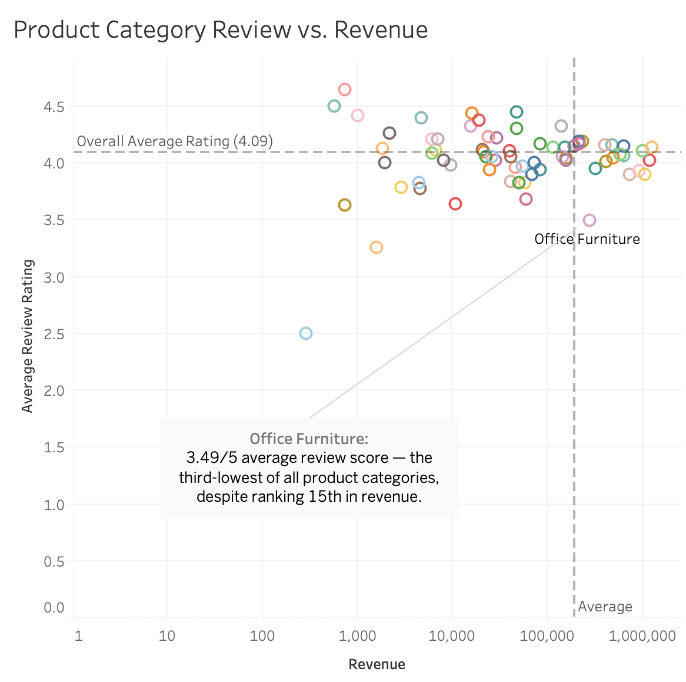

Office Furniture was the 15th-highest revenue category but had the third-lowest average review score (3.49/5), making it a priority for investigation. Bed, Bath & Table ranked third for revenue but 13th-lowest for reviews at 3.9/5, close to the overall average of 4.09/5, so this is not necessarily a serious problem. Furniture & Decor and Computer Accessories also combined substantial revenue with somewhat lower scores, while most other categories were reviewed well.

### Delivery Time and Review Scores

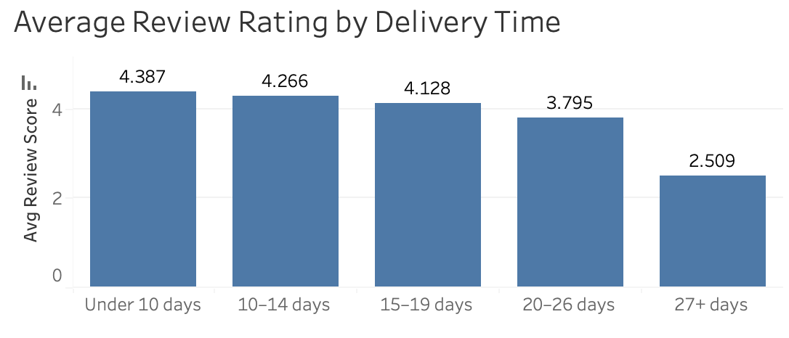

Average delivery time was 12.56 days, ranging from 0.5 to 209 days. Review scores fell steadily as delivery times lengthened:

| Delivery time | Average review score |
|---|---|
| Under 10 days | 4.39 / 5 |
| 10–14 days | 4.27 / 5 |
| 15–19 days | 4.13 / 5 |
| 20–26 days | 3.79 / 5 |
| 27 days or more | 2.51 / 5 |

Deliveries taking 27 days or more (6,158 reviews) scored 1.88 points below those under 10 days. This is a strong association, but it does not prove that delivery time directly causes lower scores.

### Regional Differences in Long Deliveries

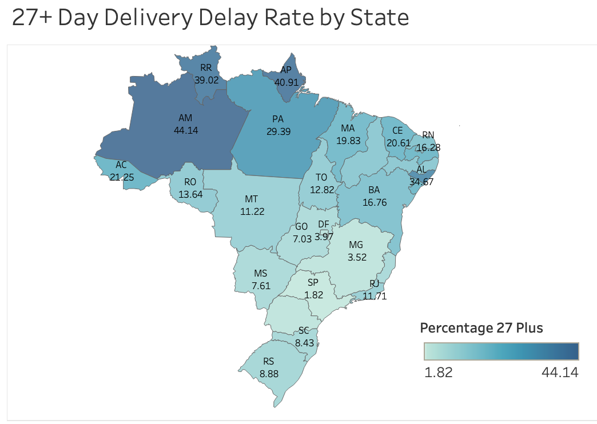

Long deliveries varied sharply by state. Amazonas had the highest rate, with 44.14% of deliveries taking 27 days or longer, compared with 1.82% in São Paulo. Results for low-volume states such as Amazonas, Amapá and Roraima should be treated cautiously because small samples give less stable percentages. Alagoas, Pará, Bahia, Ceará and Maranhão are stronger candidates for investigation because they combine high rates with larger delivery volumes. Together, the number of long deliveries shows the scale of the issue and the percentage shows how widespread it is.

### Seller-Level Delivery Performance

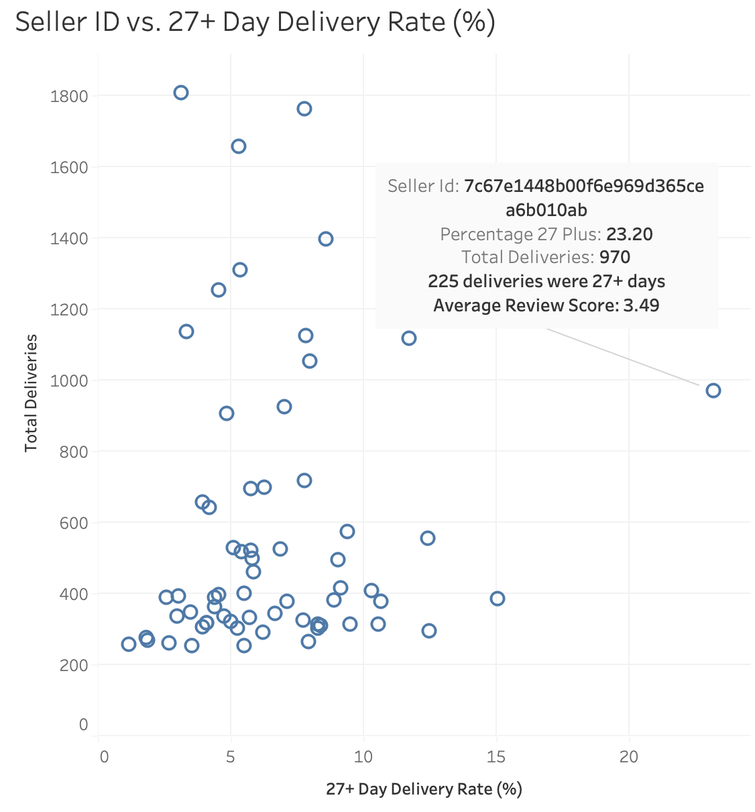

Long deliveries were not evenly spread across sellers. Seller `7c67e1448b00f6e969d365cea6b010ab` stood out, with 225 of 970 deliveries (23.2%) taking 27 days or longer and an average review score of 3.49/5. Considering both volume and rate matters, because a high percentage based on very few deliveries is less significant than a similar rate affecting many customers.

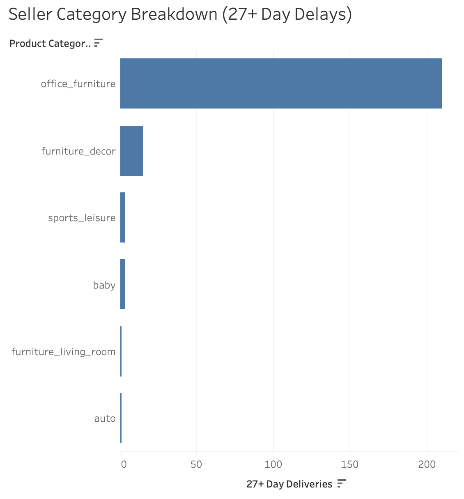

Office Furniture accounted for 210 of this seller's 225 long deliveries (93.3%), spread across many individual products rather than one or two (the highest-volume product accounted for 20 long deliveries and the next for 13). The seller was responsible for 70.35% of Olist's Office Furniture sales but 80.77% of its long deliveries. This points to a broader seller-category delivery issue rather than a problem with individual products, although the underlying cause has not been established.

**Implication:** Olist could work with the seller and its logistics partners to review dispatch times, routes, handling of bulky items and the accuracy of delivery estimates, and keep customers informed when delays occur. Because Olist is a marketplace, any changes to dispatch or fulfilment would need to be agreed with the seller and logistics providers.

---

## 4. Customer Retention Analysis

### Repeat Purchase Behaviour

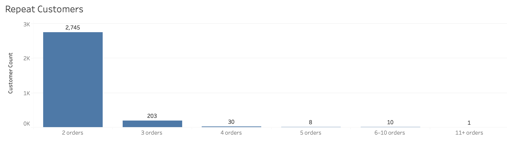

Of 96,096 customers, only 2,997 placed more than one order, a repeat rate of 3.12%. Most returning customers placed exactly two orders (2,745, or 91.6%), 203 (6.77%) placed three, and only 49 placed four or more. The main retention opportunity is therefore encouraging a second purchase. These figures should be read in the context of the observation period, as customers whose first order came near the end of the data had less time to return.

### Repeat Purchasing by Product Category

<table>
  <tr>
    <td align="center">
      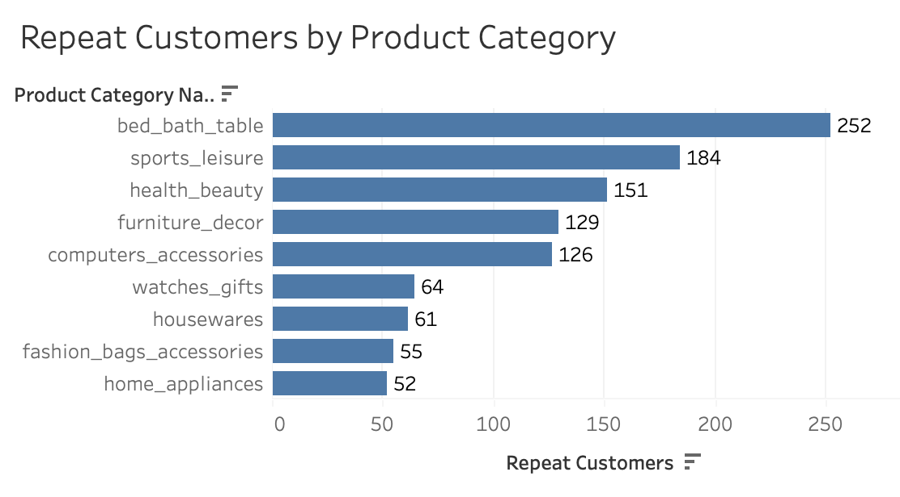
    </td>
    <td width="30"></td>
    <td align="center">
      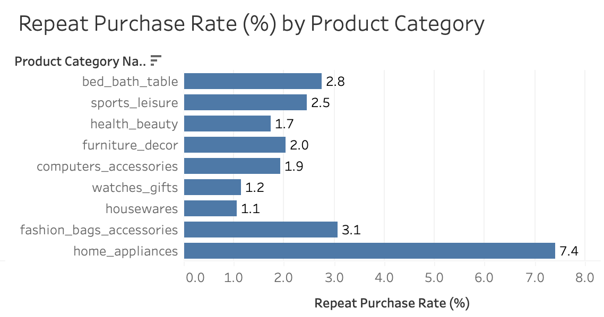
    </td>
  </tr>
</table>

Repeat-customer volume and repeat-purchase rate told different stories:

- **Highest volume:** Bed, Bath & Table generated the most repeat customers (252), followed by Sports & Leisure (184) and Health & Beauty (151). These large categories contribute many returning customers despite modest rates (2.76% for Bed, Bath & Table and 2.45% for Sports & Leisure).
- **Highest rate:** Home Appliances recorded the highest rate among the displayed categories at 7.40% (52 repeat customers from 703), followed by Fashion Bags & Accessories at 3.06% (55 repeat customers).
- **Lowest rates:** Electronics (0.39%), Miscellaneous & Novelty Products (0.47%) and Stationery (0.65%).

A category can have a high rate but few returning customers, or a lower rate but many. Low-rate categories should not automatically be treated as underperforming, as they may simply reflect longer replacement cycles. Home Appliances warrants further investigation, although the analysis does not explain why its customers return more often.

**Implication:** Olist could help sellers encourage second purchases through post-purchase emails, relevant product recommendations and targeted promotions, measured by subsequent orders and revenue. Large categories suit complementary-product recommendations, while Home Appliances and Fashion Bags & Accessories could be examined for retention approaches that transfer elsewhere.

---

## Key Recommendations

- **Support seasonal planning:** Share historical demand insights with sellers ahead of the Q4 peak, particularly in Stationery, Electronics, Watches & Gifts, Toys, Garden Tools and Console Games, and coordinate with logistics partners before November and December. Use category-specific promotions outside Q4, such as Housewares in Q2 and Office Furniture in July.
- **Investigate delivery performance:** Prioritise Office Furniture, high-volume sellers with high long-delivery rates and regions where delays are both common and affect many customers, using volume and percentage together rather than percentages alone.
- **Assess sellers on combined metrics:** Evaluate sellers using sales volume, revenue, delivery performance and reviews rather than any single measure.
- **Encourage repeat purchasing:** Focus on converting first-time customers into second-time buyers, tailoring tactics to category purchasing patterns.
- **Investigate seasonal and retention drivers further:** Use product-level data, promotions and launch information to distinguish recurring seasonal demand from isolated spikes.
- **Monitor outcomes:** Track long-delivery rates, review scores, repeat-purchase rates and revenue to test whether any changes work.

## Project Limitations

- **Limited seasonality data:** Only 2017 was a complete calendar year, so patterns may not recur in other years.
- **Profitability not measured:** Product and freight revenue could be calculated, but missing cost data prevented profit analysis.
- **Association, not causation:** Relationships between delivery times, reviews and repeat purchasing do not establish cause and effect.
- **Limited operational detail:** The dataset does not show the precise causes of delays or which party was responsible. As Olist uses independent sellers and delivery companies, the recommendations focus on investigating issues, tracking performance and working with sellers to make improvements.
- **Retention measurement:** Customers who ordered near the end of the dataset had less time to return. Category-level repeat purchasing also misses customers who returned to buy from a different category, so it should not be read as overall retention.

## Tableau Dashboards

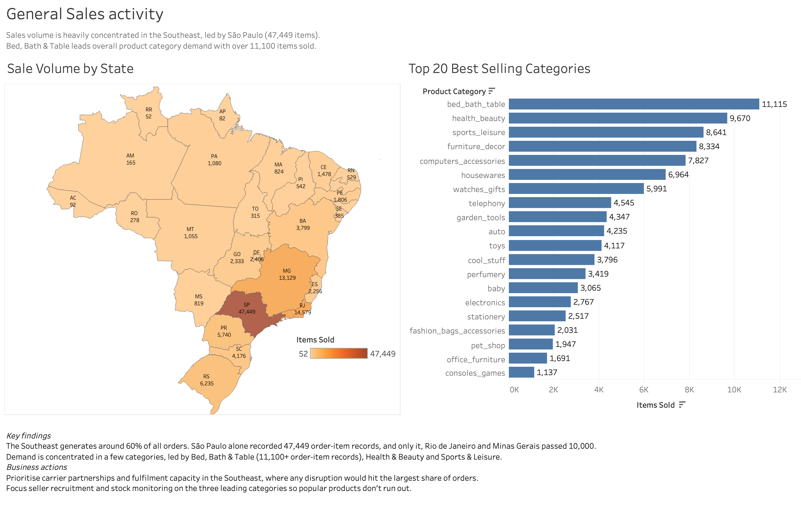

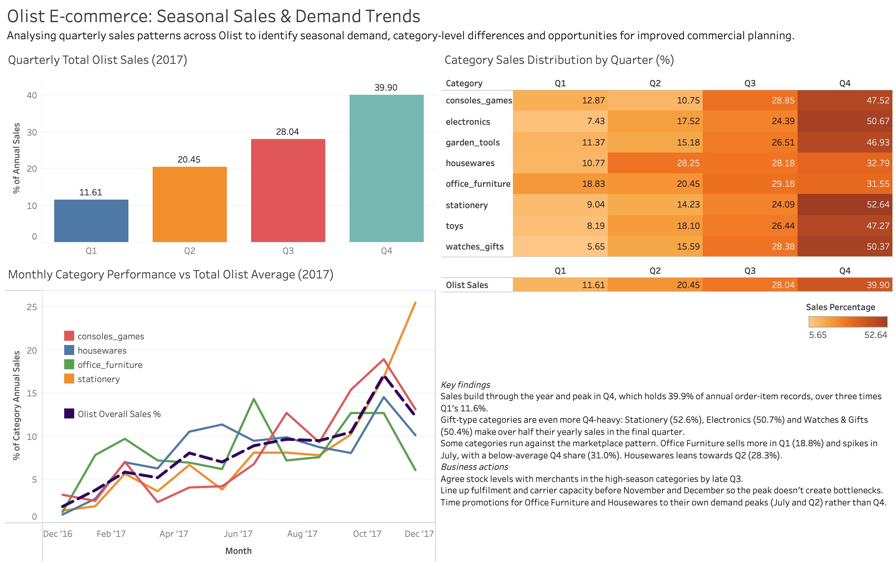

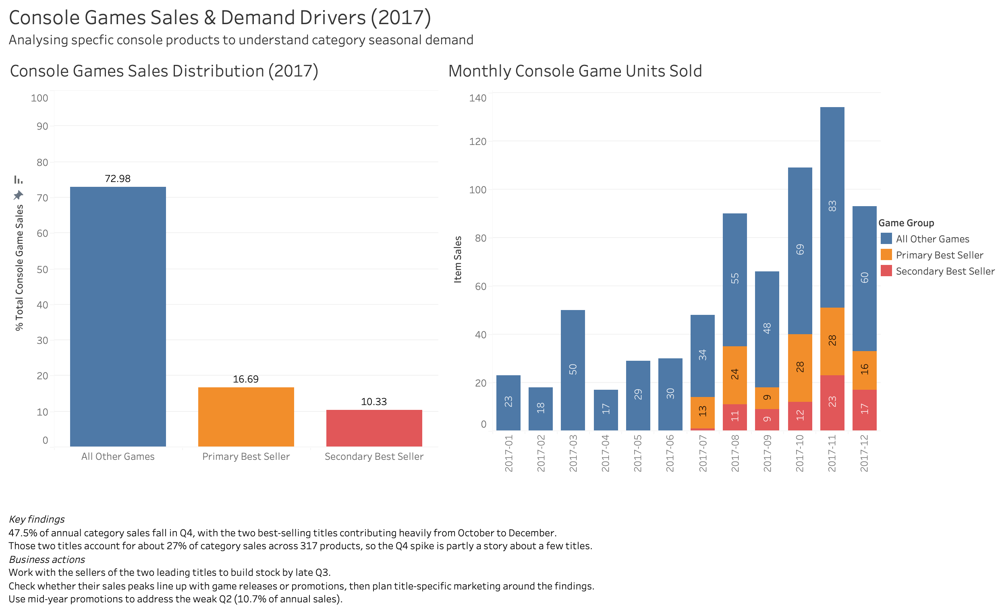

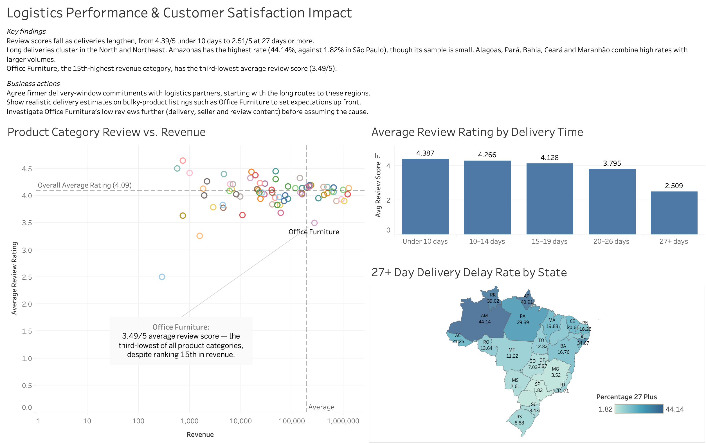

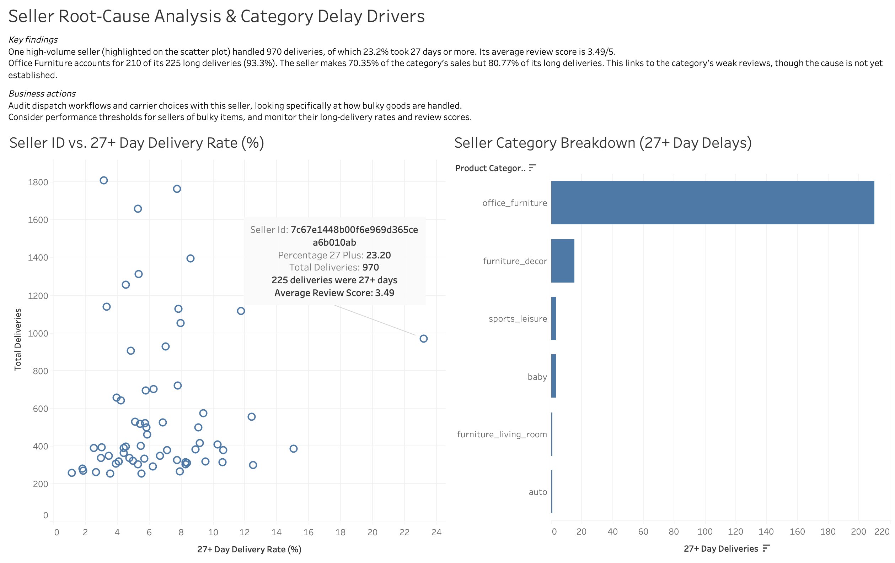

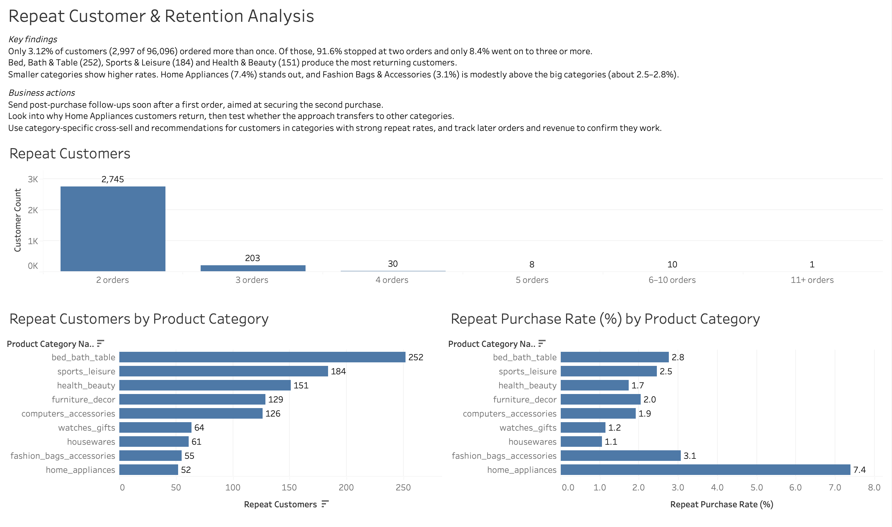

## Tools

- **SQL (SQLite):** Data cleaning, joining tables, aggregation and analysis
- **Tableau:** Interactive dashboards and data visualisation
- **GitHub:** Project documentation, SQL files and portfolio presentation

## Project Files

